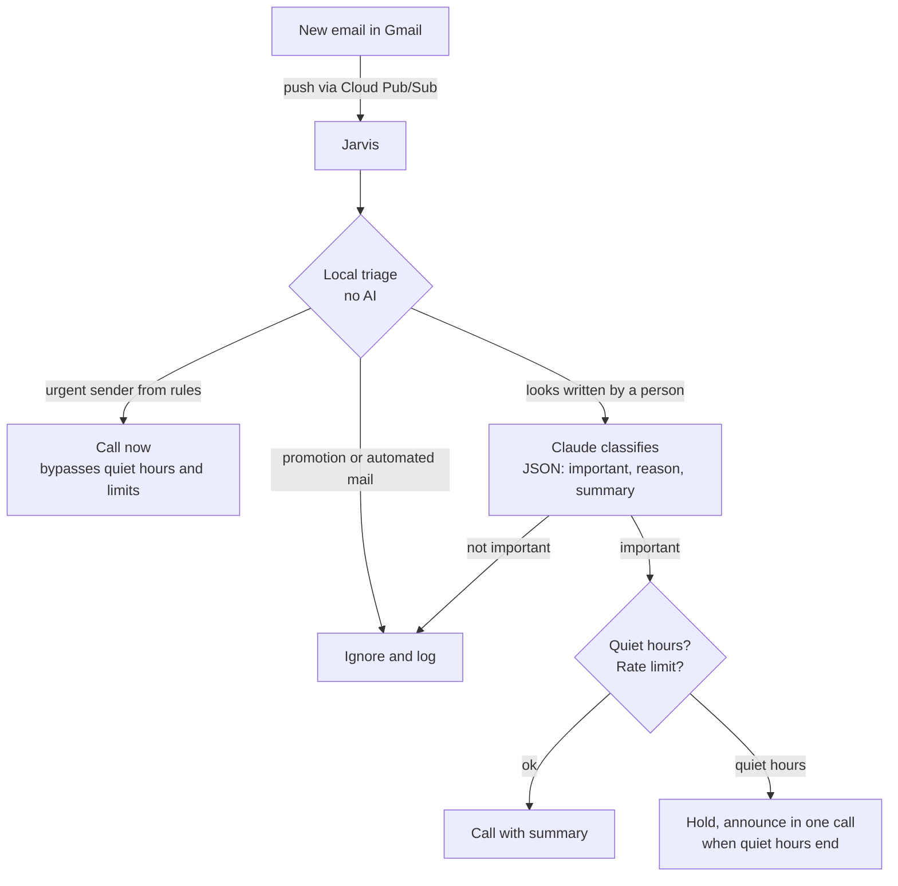

# Jarvis

A personal assistant that **phones me** when something important happens: a calendar event that is about to start, or an email that cannot wait.

I built it because I kept missing time-sensitive freelance job notifications. Push notifications are easy to ignore; a ringing phone is not. Jarvis runs unattended on a free-tier cloud VM, reads my Google Calendar and Gmail (read-only), decides what deserves an interruption, and places a short text-to-speech call that says what it is about.

> The code, log messages and spoken messages are in Romanian, because that is the language the assistant speaks to me in. This README explains everything in English.

## What it does

- **Calendar** – calls 30 minutes before events I marked as important (a specific event color), at 09:00 for important all-day events, and once at 18:00 for birthdays (one call for all birthdays of the day).
- **Email** – reacts to new mail within seconds (Gmail push notifications):
  - mail from a short list of *urgent senders* triggers an immediate call, even at night;
  - promotions and anything sent automatically by a system are dropped locally;
  - mail that looks written by a person is classified by an LLM, and important mail triggers a call with a one-sentence summary.
- **Manners** – quiet hours (everything that happened overnight is announced in a single call in the morning), a rate limit on calls, one retry if I do not answer.
- **Resilience** – remembers what it already announced across restarts, retries on network errors with backoff, falls back to a second voice if the primary one is unavailable, and calls me once if its Google authorization needs to be renewed.

## How an email travels



Calendar events go through the same last step: a decision function, then the shared announcement path with quiet hours, limits, retry and memory.

## Design decisions

- **A phone call, not a notification.** The whole point is to be hard to miss. The message is sent inline when the call is created (TwiML), so no public web server is needed.
- **Rules live in a file, not in code.** `reguli_importanta.md` is a plain, human-editable file (what counts as important, lead time, quiet hours, limits, urgent senders, and a plain-language description of important mail). It is re-read on every check, and mistakes are reported with the line number instead of crashing.
- **Allow-list thinking for email.** Instead of maintaining an endless block-list of senders, the triage lets through only what could matter: a short list of chosen platforms, and mail written by people. Everything machine-generated (codes, receipts, confirmations, delivery updates, newsletters) is dropped before any AI sees it. This keeps cost and data exposure low.
- **The LLM is a classifier, not an agent.** It receives the sender, subject and the beginning of the text, and returns structured JSON validated against a schema. The code acts only on the boolean field. The model never receives credentials and cannot take actions. The prompt treats the email as untrusted data, so an email asking to be "marked as important" does not change the verdict.
- **Explicit time zone everywhere.** All comparisons use `Europe/Bucharest`, so the server's own clock and location do not matter.
- **Every decision is logged.** Event or email, verdict, reason, and the outcome of the call, in a log a person can read. Email bodies are never stored.
- **Secrets stay out of the repo.** Keys are read from `.env` at runtime; OAuth files are git-ignored; error messages mask account identifiers and phone numbers.

## Tech stack

| Area | Choice |
|---|---|
| Language | Python 3.12+ (developed on Windows, deployed on Linux) |
| Calendar and mail | Google Calendar API, Gmail API (read-only scopes) |
| Push | Gmail `watch` + Google Cloud Pub/Sub (pull, no public IP needed) |
| Calls | Twilio Programmable Voice, text-to-speech |
| Classification | Claude API (Haiku) with structured JSON output |
| State | SQLite (standard library) |
| Logging | `logging` with rotating files |
| Deployment | systemd service on a Google Compute Engine free-tier VM |
| Tests | `unittest` with fake calendar, mailbox, classifier and calls |

Dependencies are few and pinned in `requirements.txt`.

## Project layout

```
jarvis/
  __main__.py         command-line entry point
  serviciu.py         main loop: calendar polling, email listening, announcements
  calendar_google.py  Google authorization and calendar reading
  gmail.py            Gmail reading and Pub/Sub listening
  triere.py           local email triage (no AI)
  clasificare.py      email classification with Claude
  decizie.py          calendar decisions and spoken messages
  reguli.py           parser for the rules file, with line-level error messages
  apel.py             Twilio calls and voice fallback
  memorie.py          SQLite memory (announced items, held items, retries)
  jurnal.py           human-readable rotating log
  config.py           reads and validates keys from .env
reguli_importanta.md  the editable rules
tests/                automated tests
deploy/jarvis.service systemd unit
```

## Running it

You need a Google Cloud project (Calendar API, Gmail API and Pub/Sub enabled, an OAuth desktop client, a Pub/Sub topic and pull subscription that Gmail may publish to), a Twilio number, and a Claude API key.

```bash
python -m venv .venv
.venv/bin/pip install -r requirements.txt   # on Windows: .venv\Scripts\pip
cp .env.example .env                        # then fill in your own keys
```

Set your Google Cloud project ID in `jarvis/gmail.py`, put the OAuth client file next to the code as `credentials.json`, then:

| Command | What it does |
|---|---|
| `python -m jarvis autorizare` | one-time Google authorization in the browser |
| `python -m jarvis apel-test` | places a test call, to verify Twilio |
| `python -m jarvis verifica-reguli` | validates the rules file |
| `python -m jarvis evenimente` | lists upcoming calendar events |
| `python -m jarvis email-test [--cu-claude]` | shows what would be decided for the latest emails; no calls, nothing stored |
| `python -m jarvis porneste --proba` | dry run: decides and logs everything, never calls |
| `python -m jarvis porneste` | runs for real |

On the server it runs as a systemd service with automatic restart; see `deploy/jarvis.service` (replace `UTILIZATOR` with your user).

## Tests

```bash
python -m unittest -v
```

The tests use a fake calendar, mailbox, classifier and phone, plus a temporary database, so they place no calls and touch no real data. They cover recurring events, the email triage, urgent senders bypassing quiet hours and limits, overnight mail announced in the morning, and recovery when the classifier is unavailable.

## Privacy

Jarvis is a single-user tool that connects only to my own accounts, with read-only access. Machine-generated mail and promotions never leave the app. For the remaining mail, the sender, subject and the beginning of the text are sent to the classifier; the text to be spoken is sent to the telephony provider. Nothing is sold or shared for any other purpose, and email bodies are not stored.

## Limitations

- Built for one user; there is no multi-user support or web interface.
- The triage relies on Gmail's categories and common sender patterns, so an important automated notification from a platform that is not on the urgent list will be ignored (it is still logged).
- A voicemail that answers the call looks like a human answer, so no retry happens in that case.
- Text-to-speech reads Romanian; subjects in other languages can sound odd.

## How it was built

I defined the requirements, the architecture and the rules, set up and configured the cloud services, and tested every step end to end. I built it incrementally, one verified step at a time, with [Claude Code](https://claude.com/claude-code) as a pair programmer.
